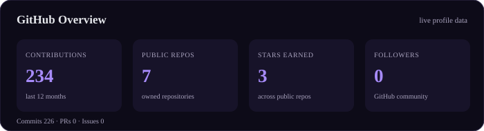
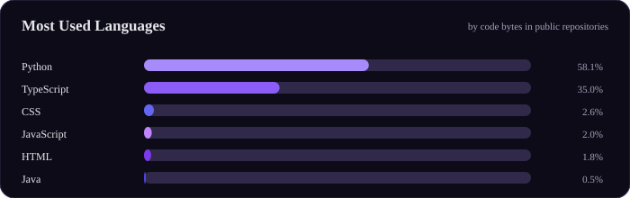
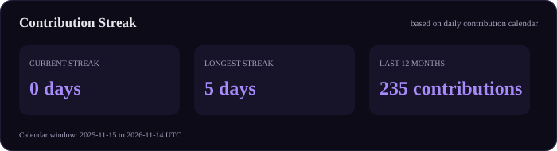
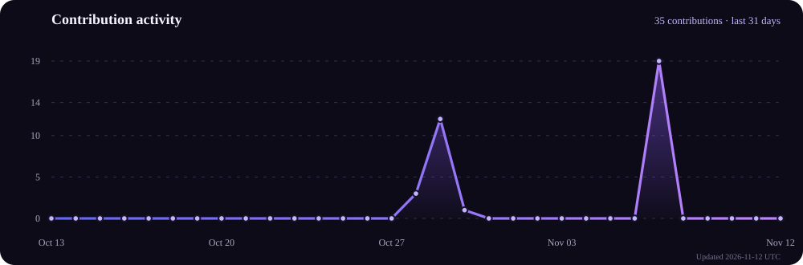

<div align="center">


<a href="https://readme-typing-svg.demolab.com"></a>

<br/>


<br/><br/>

<a href="https://www.linkedin.com/in/prasoon--kashyap"></a>
<a href="mailto:prasoonkashyapofficial@gmail.com"></a>
<a href="https://github.com/prasoonkashyap18"></a>
<a href="https://tryhackme.com/p/PrasoonKashyap"></a>

<br/><br/>


</div>

---

## About

I'm a Computer Science and Engineering undergraduate at **Lloyd Institute of Engineering and Technology**, affiliated with AKTU, interested in building useful software and understanding how systems can be made more secure.

My work sits at the intersection of **software engineering, cybersecurity, and applied AI**. I enjoy taking a problem from its requirements through architecture and implementation, then documenting what works, what doesn't, and what should come next.

- Building web applications and practical developer tools.
- Exploring network security, security operations, and machine-learning-assisted threat detection.
- Working across frontend interfaces, backend APIs, databases, and data-processing workflows.
- Interested in product engineering, engineering fundamentals, and maintainable systems.

**Open to:** software development internships, cybersecurity opportunities, AI/ML projects, and collaborative engineering work.

---

## Tech Stack

<div align="center">

**Languages**


**Frontend**


**Backend & Databases**


**Cloud, DevOps & Tooling**


</div>

**Security & networking:** Nmap · Metasploit · Wireshark · Burp Suite · SIEM tools · TCP/IP · HTTP/HTTPS · DNS · UDP · OSI model

---

## AI / ML & Engineering Areas

| Domain | Current experience | Details |
|---|---|---|
| Applied machine learning | Project experience | scikit-learn model workflow, traffic classification concepts, prediction confidence and severity outputs |
| Data processing | Project experience | Python, NumPy, xarray, preprocessing and working with structured scientific data |
| AI-enabled security | Project experience | AI-IDS concept and staged implementation for network-traffic analysis |
| Full-stack development | Project experience | React, TypeScript, Tailwind CSS, FastAPI and API-driven application design |
| Cybersecurity | Internship & hands-on learning | Network reconnaissance, vulnerability assessment, security logs and penetration-testing tools |

---

## Featured Projects

<details>
<summary><strong>BlueNexus | 3D Ocean Data Visualization Platform</strong> · Smart India Hackathon 2026</summary>

An interactive 3D platform developed for the INCOIS Smart India Hackathon problem statement. It brings authoritative ocean datasets and observations into a unified visualization experience.

| Dimension | Details |
|---|---|
| Stack | React 19, TypeScript, Three.js, FastAPI, Python, xarray, NumPy |
| Scale | Ocean model datasets, Argo float profiles and underwater-glider observations |
| Performance | Includes scoped data loading and scientific comparison metrics; no benchmark claim |
| Security & reliability | Read-only API design, explicit data provenance, structured error responses and no synthetic-data fallback |
| Impact | Makes ocean conditions and model-versus-observation comparisons easier to explore |
| Repository | [BlueNexus-SIH-2026](https://github.com/prasoonkashyap18/BlueNexus-SIH-2026) |

**Engineering notes**
- Visualizes ocean temperature, salinity and surface-current data in an interactive 3D scene.
- Integrates Argo float and underwater-glider observations.
- Compares model temperature with observations and presents methodology and provenance transparently.

</details>

<details>
<summary><strong>AI-Based Intrusion Detection System (AI-IDS)</strong> · In development</summary>

A web-based intrusion-detection project focused on analyzing network-flow data with a machine-learning pipeline and presenting reviewable security findings. The repository documents an incremental MVP; planned capabilities are distinguished from implemented work.

| Dimension | Details |
|---|---|
| Stack | React, TypeScript, Tailwind CSS, FastAPI, Python, scikit-learn, SQLite |
| Scale | MVP scope: uploaded network-traffic CSV data |
| Performance | Model evaluation and measured benchmarks are to be documented after implementation |
| Security | Input validation and controlled data processing are part of the MVP design |
| Impact | A learning and engineering platform for exploring ML-assisted network threat detection |
| Repository | [Intrusion-Detection-System](https://github.com/prasoonkashyap18/Intrusion-Detection-System) |

**Engineering direction**
- Build a clear data path from CSV ingestion through validation, preprocessing and model inference.
- Return predictions with confidence and severity information.
- Persist results for review in a dashboard; advanced SOC features remain future work.

</details>

<details>
<summary><strong>CyberShield Security Log Analyzer</strong> · Java</summary>

A Java application that parses authentication logs, identifies suspicious login activity and generates structured security reports.

| Dimension | Details |
|---|---|
| Stack | Java, OOP, ArrayList, HashMap, HashSet, file and exception handling |
| Scale | Local authentication-log files |
| Performance | No formal throughput benchmark published |
| Security | Flags repeated failed logins and suspicious users or IP addresses |
| Impact | Produces login statistics, risk summaries and a timeline for security-log review |
| Repository | [CyberShield-Security-Log-Analyzer](https://github.com/prasoonkashyap18/CyberShield-Security-Log-Analyzer) |

**Engineering notes**
- Parses log entries into structured objects.
- Reports unique users and IP addresses, suspicious activity and overall risk level.
- Applies Java Collections and object-oriented design to a practical security use case.

</details>

---

## Experience

### Cybersecurity Intern | IBM
**August 2026 – October 2026**

- Gained hands-on experience in ethical hacking, vulnerability assessment and network reconnaissance.
- Used Nmap for reconnaissance and explored penetration-testing workflows with Metasploit.
- Worked on an AI-based Intrusion Detection System project focused on network-traffic analysis and threat-severity assessment.

**Skills:** Cybersecurity · Network Reconnaissance · Nmap · Metasploit · Vulnerability Assessment · Machine Learning

---

## Achievements

<div align="center">

| Recognition | Details |
|---|---|
| Smart India Hackathon 2026 | Selected as a representative team member for Lloyd Institute of Engineering and Technology |
| TryHackMe | Ranked in the top 8% of users |
| JEE Main 2025 | All India percentile: 88 |
| Academics | Class X: 90.1% · Class XII: 76.4% |

</div>

---

## Certifications

**Google**

<a href="https://www.coursera.org/account/accomplishments/specialization/V347H4GFKE94"></a>

Eight-course professional certificate covering network security, Linux, SQL, SIEM, incident response, risk assessment, security auditing and cybersecurity practices.

**MongoDB**

<a href="https://www.credly.com/users/prasoon-kashyap.1c1df5d9"></a>

Completed five official skill courses covering MongoDB fundamentals, AI strategy, AI agents, vector search and RAG.

**NASSCOM**

<a href="https://www.futureskillsprime.in/iDH/fsp/Dashboard/SkillPassport"></a>

Covered data preprocessing, visualization, statistical analysis and interpretation of datasets; assessment score: 94%.

---

## Coding & Security Profiles

<div align="center">

<a href="https://tryhackme.com/p/PrasoonKashyap"></a>
<a href="https://github.com/prasoonkashyap18"></a>

</div>

---

## GitHub Analytics

<div align="center">



<br/>



<br/>



</div>

---

## GitHub Trophies

<div align="center">



</div>

---

## Contribution Activity

<div align="center">



</div>

---

## Contribution Snake

<div align="center">

<picture>\n  <source media="(prefers-color-scheme: dark)" srcset="https://raw.githubusercontent.com/prasoonkashyap18/prasoonkashyap18/output/github-contribution-grid-snake-dark.svg" />\n  <source media="(prefers-color-scheme: light)" srcset="https://raw.githubusercontent.com/prasoonkashyap18/prasoonkashyap18/output/github-contribution-grid-snake.svg" />\n  \n</picture>

</div>

---

## Current Focus

```yaml
learning:
  - Data Structures & Algorithms
  - Advanced Java and problem solving
  - Backend engineering and API design
  - Applied machine learning

building:
  - AI-Based Intrusion Detection System
  - Full-stack applications
  - Practical cybersecurity tools

exploring:
  - Network security and threat detection
  - AI-assisted security workflows
  - Scalable and maintainable software architecture

open_to:
  - Software engineering internships
  - Cybersecurity opportunities
  - AI/ML collaborations
  - Open-source projects
```

---

## Connect

<div align="center">

<a href="mailto:prasoonkashyapofficial@gmail.com"></a>
<a href="https://www.linkedin.com/in/prasoon--kashyap"></a>
<a href="https://github.com/prasoonkashyap18"></a>
<a href="https://tryhackme.com/p/PrasoonKashyap"></a>

</div>

---

<div align="center">

*Build with curiosity. Engineer with intent. Secure by design.*


</div>
